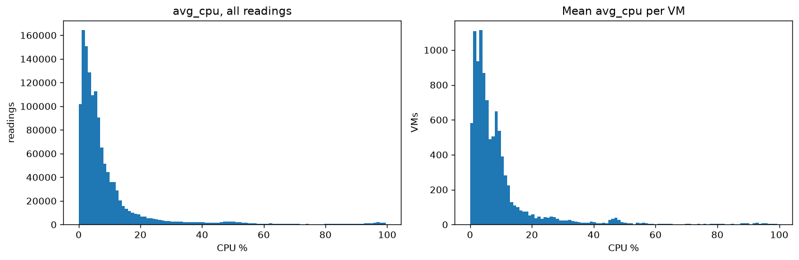
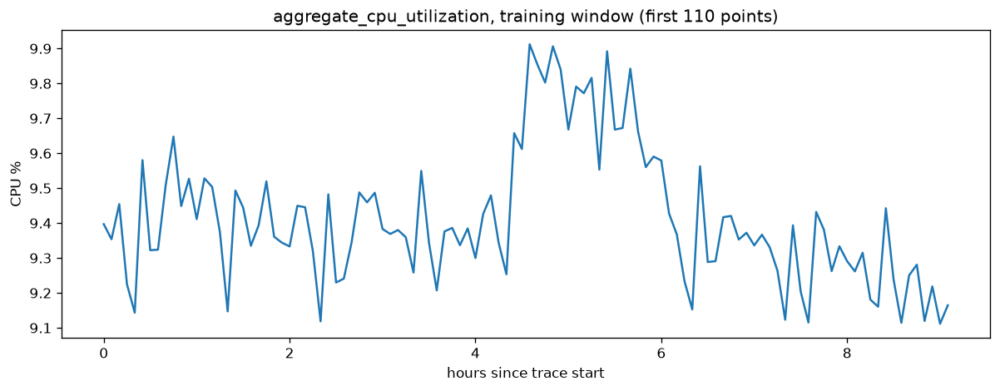
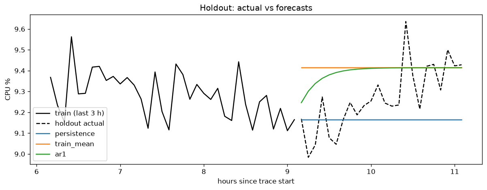
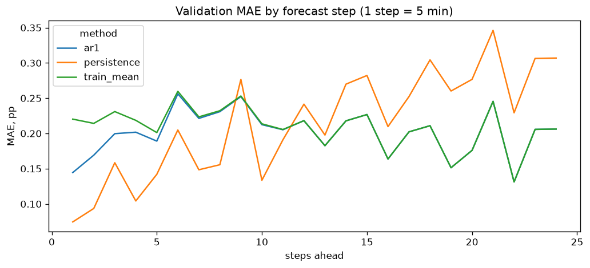
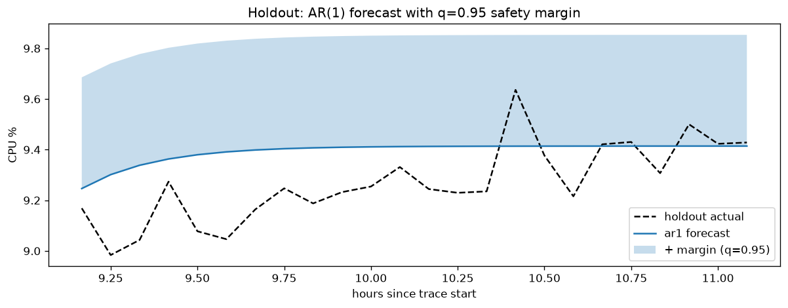

# Cloud Workload Forecasting: Final Report

Forecasting near-term aggregate demand on a 10,000-VM subset of the Microsoft
Azure Public Dataset V2 (`data-v1` release).

| Term | Meaning |
|---|---|
| pp | percentage points of CPU utilization (9.40% + 0.44 pp = 9.84%) |
| MAE | mean absolute error |
| RMSE | root mean squared error; penalizes large misses more than MAE |
| sMAPE | symmetric mean absolute percentage error |
| AR(1) | first-order autoregressive model: the next value depends on the previous one |
| persistence | baseline that repeats the last observed value |
| holdout | the final 24 points (2 h), used once for the final evaluation |

## 1. Executive summary

- **The data is clean but heavily curated.** All 10,000 VMs have all 134 readings
  on a regular 5-minute grid (11.1 h). Only complete traces were kept, so
  `active_vm_count` is constant at 10,000 and VM churn is not observable in the
  window.
- **The aggregate CPU series is very smooth and close to unpredictable noise.**
  Averaging 10,000 VMs gives a level of ~9.4% with a standard deviation of only
  0.19 pp; the best model's MAE (0.20 pp, ~2% relative) is about the size of that
  standard deviation.
- **Final model: AR(1) (mean-reverting).** It starts from the last observed value
  and decays to the mean within ~30 minutes. On 7 rolling-origin validation folds
  it has the lowest MAE (0.201 pp vs 0.215 for persistence, −6.6%) and is never the
  worst method in any fold. On the 24-point holdout, persistence is 4% better on
  MAE (0.147 vs 0.153) while AR(1) is slightly better on RMSE.
- **Main failure mode:** AR(1) under-forecasts load peaks by ~0.4 pp.
- **Recommendation:** provision **AR(1) forecast + 0.44 pp (≈ +4.7% headroom)**,
  the 95th percentile of validation under-forecast errors. It covered all 24
  holdout points. Latency-sensitive (Interactive) workloads need extra burst
  headroom on top, because 5-minute averages hide short peaks.

## 2. Data understanding and preprocessing

**Contents.** `vm_cpu_readings` has 1,340,000 rows (10,000 VMs × 134 timestamps)
with `min_cpu`, `avg_cpu`, `max_cpu`; `vm_metadata` has one row per VM with
category, core and memory buckets and creation/deletion times.

**Time grid.** Timestamps are seconds from the start of the source trace:
134 unique values from 0 to 39,900 s, all 133 gaps exactly 300 s. No gaps,
no duplicate `(vm_id, timestamp)` pairs, no missing values. All CPU values are
within [0, 100] and satisfy `min ≤ avg ≤ max`.

**Where the window sits.** Every VM has `timestamp_vm_created = 0` and the
metadata spans the full 30-day trace (last deletion at 2,591,400 s). The window is
therefore the **first ~11 hours** of the trace; VMs created earlier are clipped to 0.
82% of VMs survive to the end of the 30 days, and the earliest deletion
(40,500 s) is just after the window ends: VMs deleted inside the window were
excluded by the "complete traces only" selection (**survivorship bias**).

**Target construction** (`src/cwfc/targets.py`):

- `active_vm_count(t)` — number of distinct VMs with a non-missing `avg_cpu` at `t`.
- `aggregate_cpu_utilization(t)` — mean of per-VM `avg_cpu` at `t`, in %.
- Rows with missing `avg_cpu` are dropped. Duplicate readings of the same VM at the
  same timestamp are averaged first, so each VM counts once in **both** targets.
  A unit test found that an earlier version averaged rows and double-counted
  duplicates; it was fixed before the final run.
- No values are imputed. A timestamp with no valid readings would simply be absent.
- The full 134-point target series is built first; then the first 110 points are
  the training window and the last 24 the holdout.

## 3. Workload analysis

**Most VMs are lightly loaded.** VM-level `avg_cpu` is strongly right-skewed:
mean 9.4%, median 5.1%, 75% of readings below 9.6%. A small tail runs hot: 9.8% of
VMs average above 20%, 2.2% above 50% and 0.9% above 80%.



**Short bursts are hidden by averaging.** Within each 5-minute interval the peak
is about twice the average (median `max_cpu` 9.1% vs `avg_cpu` 5.1%).

**Segments.** 62% Delay-insensitive, 31% Interactive, 7% Unknown; 75% of VMs have
2 cores.

| category | VMs | mean CPU % | median CPU % |
|---|---|---|---|
| Delay-insensitive | 6,180 | 8.24 | 5.62 |
| Interactive | 3,091 | 11.49 | 5.56 |
| Unknown | 729 | 10.23 | 3.89 |

Interactive VMs have the same median as Delay-insensitive ones but a much heavier
upper tail. There is no clear relationship between core count and utilization
(4-core VMs are the least loaded; the 24 and >24 buckets have only 62 and 10 VMs).

**Temporal pattern of the target.** On the training window the aggregate CPU stays
between 9.1% and 9.9% (mean 9.41%, std 0.19 pp). Averaging 10,000 VMs cancels most
individual bursts. Two features matter for forecasting:

- point-to-point noise of ~0.1–0.2 pp;
- one **elevated episode** at ~4.5–6 h (up to 9.9%), after which the series
  **reverts** to ~9.4%.



The window is shorter than a day, so daily seasonality cannot be observed and a
daily seasonal-naive baseline is impossible. Only the training window was plotted
during analysis; the holdout was not looked at before model selection.

## 4. Forecasting approach

**`active_vm_count`.** Constant at 10,000 by construction. Any reasonable method
(persistence, mean, AR(1) with `phi = 0`) forecasts it exactly; I use the same
AR(1) code, which reduces to the mean.

**`aggregate_cpu_utilization`.** Candidates, all forecasting 24 steps from an
origin using only data before it:

| method | rule |
|---|---|
| persistence | last observed value |
| ma_6 / ma_12 | mean of the last 30 / 60 minutes |
| train_mean | mean of all history before the origin |
| **AR(1)** | `mu + phi^h · (last − mu)` |
| lag regression | linear regression on lags 1–3 and rolling means (6, 12), recursive |

**Why AR(1).** The baseline comparison (section 6) showed that persistence wins in
calm periods and the mean wins after an excursion, when the series reverts. AR(1)
is the simplest model that combines both: close to the last value at short
horizons, close to the mean at long ones. It is fitted by least squares on
deviations from the mean; `phi` is clipped to [0, 1] so the forecast cannot explode
or oscillate. On the full training window `mu = 9.414`, `phi = 0.672`, so
`phi^h` is 0.67, 0.09, 0.01, 0.00 for h = 1, 6, 12, 24: deviations decay within
~30 minutes.

**Feature availability.** All features are lags or rolling statistics of the target
computed strictly before the forecast origin. No calendar features are used:
timestamps are relative and the window is under a day.

The lag regression was added later as a comparison (section 6) and is not used
for the final forecast.

## 5. Validation methodology

Rolling-origin evaluation **inside the 110-point training window**:

- horizon 24 (same as the holdout), minimum 48 points of history, step 6 (30 min);
- origins anchored at the end of the window: 50, 56, …, 86, so the last fold ends
  exactly at point 109 → **7 folds, 168 forecast points per method**;
- each fold sees only data before its origin, exactly as in production.

Folds starting at 50–62 contain the elevated episode, so methods are also tested
on a level shift.

**Holdout protocol.** The model choice was committed to git before the holdout
section of the notebook was written (commits `8a3d9f1` → `a1a67d7`). The holdout
was then used once. `predict.py` reads only the holdout timestamps, and
`tests/test_predict.py` checks that overwriting every holdout value leaves the
predictions unchanged; I confirmed the test fails if the model is fitted on the
full series.

## 6. Results versus baselines

**Validation (7 folds, mean over folds):**

| method | MAE | RMSE | MAE vs persistence |
|---|---|---|---|
| **AR(1)** | **0.201** | **0.230** | **−6.6%** |
| train_mean | 0.209 | 0.238 | −3.0% |
| persistence | 0.215 | 0.251 | — |
| lag regression | 0.221 | 0.253 | +2.6% |
| ma_6 | 0.243 | 0.272 | +12.8% |
| ma_12 | 0.260 | 0.288 | +20.6% |

Per fold (MAE):

| origin | AR(1) | persistence | train_mean |
|---|---|---|---|
| 50 | 0.303 | **0.268** | 0.303 |
| 56 | **0.265** | 0.296 | 0.271 |
| 62 | **0.150** | 0.297 | 0.173 |
| 68 | **0.152** | 0.301 | 0.164 |
| 74 | 0.168 | **0.124** | 0.171 |
| 80 | 0.165 | **0.087** | 0.170 |
| 86 | 0.204 | **0.132** | 0.210 |

AR(1) beats train_mean in 6 of 7 folds (one tie) and persistence in 3 of 7 (the
elevated episode and its reversion). It is never the worst method in a fold.
The gain over persistence is modest and of the same order as the fold-to-fold
variation, so I do not claim a large improvement.

**Holdout (24 points):**

| method | MAE | RMSE | sMAPE % | bias (pp) | MAE vs persistence |
|---|---|---|---|---|---|
| persistence | **0.147** | 0.185 | 1.59 | −0.10 | — |
| **AR(1)** | 0.153 | **0.183** | 1.65 | +0.12 | +4.5% |
| train_mean | 0.175 | 0.211 | 1.88 | +0.15 | +18.9% |



The holdout starts in a low, calm regime that lasts about an hour (9.0–9.25%) and
then rises to ~9.4% with a spike to 9.64%. Persistence fits the first hour; AR(1)
reverts too early and over-forecasts it, but is closer in the second hour.
This matches validation, where persistence won in calm periods. sMAPE has no
near-zero denominator problem here because the target is ~9%.

`active_vm_count`: forecast 10,000 at every holdout timestamp, MAE 0.

**Post-hoc comparison: lag regression.** Added after the holdout evaluation. On
validation it is worse than persistence (MAE 0.221): with 5 features, 40–75
training points and a noisy target it fits noise. On the holdout it is the best
method (MAE 0.096). Switching to it now would mean selecting a model on the test
set, so AR(1) remains the final model. The fact that the ranking flips between
validation and holdout shows that the differences between models are smaller than
the window-to-window variation.

## 7. Error and failure analysis

Errors pooled over the 7 validation folds.

**By horizon.** Persistence is clearly best for the first ~5 steps (≤25 min; MAE
0.07–0.16 vs 0.14–0.23). From ~10 steps on, AR(1) and the mean are better and
persistence keeps degrading. AR(1) becomes identical to the mean after ~6 steps.
At step 1 AR(1) has twice the error of persistence (0.144 vs 0.074): it reverts
**too early**, because point-to-point noise pulls the fitted `phi` down.



**At peaks** (27 validation points above the training 90th percentile, 9.668%):

| method | MAE at peaks | bias at peaks | share under-forecast |
|---|---|---|---|
| persistence | 0.216 | −0.14 | 56% |
| AR(1) | 0.389 | −0.39 | 100% |
| train_mean | 0.415 | −0.42 | 100% |

The main failure mode is that **AR(1) under-forecasts every peak** by ~0.4 pp:
it predicts the normal level and cannot anticipate an excursion. Persistence
tracks sustained peaks (such as the 4.5–6 h episode) much better once they have
started. None of the models can predict the *start* of an excursion; there is no
leading signal in a single aggregate series.

## 8. Capacity-planning recommendation

**Policy:** provision `AR(1) forecast + margin`, where the margin is an empirical
quantile of AR(1) under-forecast errors (`actual − forecast`) on the validation
folds. The holdout is only used to check the policy.

| quantile | margin (pp) | headroom | validation coverage | holdout coverage | holdout unused capacity (pp) |
|---|---|---|---|---|---|
| 0.80 | 0.21 | +2.3% | 80% | 96% | 0.34 |
| 0.90 | 0.39 | +4.1% | 90% | 100% | 0.51 |
| **0.95** | **0.44** | **+4.7%** | **95%** | **100%** | **0.56** |
| 0.99 | 0.51 | +5.4% | 99% | 100% | 0.64 |

**Recommendation: AR(1) forecast + 0.44 pp (≈ +4.7% headroom).**



- **Trade-off.** Under-provisioning hurts latency and availability; over-provisioning
  costs idle capacity. Going from q = 0.90 to 0.95 costs only +0.05 pp but halves the
  expected shortfall rate (1 in 10 → 1 in 20 intervals). q = 0.99 rests on ~2 of 168
  validation errors and is not reliable.
- The margin is about the size of AR(1)'s peak under-forecast (~0.39 pp), so it
  covers the model's main failure mode.
- **Segments.** Interactive VMs (31% of the fleet) are latency-sensitive and have the
  heaviest CPU tail; they deserve at least this margin, ideally a separate one.
- **Bursts.** This policy is on 5-minute *average* CPU. Within-interval peaks are
  ~2× higher, so latency-critical services need additional burst headroom, best
  derived from `max_cpu`.
- **Bias direction.** Persistence under-forecast the holdout (−0.10 pp); AR(1)
  over-forecast it (+0.12 pp). For capacity, AR(1)'s error is on the safer side.

## 9. Limitations and future work

**Limitations**

- **Short, early window.** 11 hours from the start of a 30-day trace; no daily or
  weekly seasonality, and a single holdout of 24 points.
- **Survivorship bias.** Only complete traces are included, so `active_vm_count` is
  artificially constant and churn cannot be modeled.
- **Low signal.** Most variation of the aggregate is unpredictable noise; model
  rankings change between windows.
- **Averages hide bursts.** All forecasts are on 5-minute averages.

**Future work** (each follows from a finding above)

- A **horizon-dependent hybrid**: persistence for the first ~30 minutes, AR(1) after.
  It looks better on validation but was not applied, to keep the holdout clean.
- A **longer trace** to learn daily seasonality and to get many more validation folds.
- **Capacity on `max_cpu`** (or a high quantile of per-VM load) instead of averages.
- **Segment-level forecasts and margins**, starting with Interactive VMs.
- A **horizon-dependent margin**: smaller for 5 minutes ahead, larger for 2 hours.
- **Include VMs created or deleted inside the window** to forecast a real
  `active_vm_count` with churn.

## Reproducibility

```bash
python -m pip install -e ".[dev,notebook]"
python -m cwfc.predict --data challenge_data --output predictions.csv
python -m pytest -q
```

Analysis: `notebooks/01_data_audit.ipynb`, `notebooks/02_forecasting.ipynb`.
Data: Microsoft Azure Public Dataset V2, `data-v1` release (not committed).
